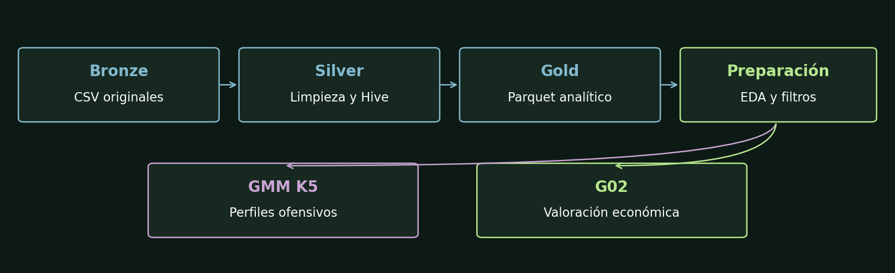

# OFFBALL. — Football Intelligence



**Ver lo que otros no ven.** Proyecto académico de Inteligencia Artificial y Big Data · Cebanc · noviembre de 2026. Equipo: Carmelo José Beato García, Igor y Byron.

OFFBALL ayuda a los clubes profesionales con presupuestos ajustados a explorar perfiles deportivos y estimar el valor de mercado de futbolistas. Es una herramienta de apoyo al scouting: una señal económica no acredita una ganga, un precio de traspaso ni la disponibilidad del jugador.

## Versión entregada: v0.4.2

- GMM extendido de cinco componentes (14 ligas): perfiles de jugadores ofensivos.
- G02: Random Forest con objetivo logarítmico, seleccionado por su rendimiento en jugadores económicamente accesibles; G01 se conserva como referencia directa.
- API FastAPI/Pydantic, frontend React/TypeScript/Vite, Docker Compose.
- Big Data: Hadoop/HDFS, Hive, arquitectura Bronze/Silver/Gold y Parquet.

## Ejecutar la aplicación

Requisitos: Docker Desktop (o Docker Engine con Compose v2), conexión para descargar las imágenes y dependencias, y los ocho artefactos originales en `OFFBALL_API/assets/`. Estos artefactos no se suben al repositorio hasta verificar los derechos de redistribución. El paquete local del equipo ya contiene los archivos; al clonar el repositorio, deben restaurarse desde una copia autorizada. Véase [preparación de assets](OFFBALL_API/README.md). No cargar Joblib de procedencia desconocida.

Desde la raíz, en PowerShell:

```powershell
python scripts/verificar_assets.py
docker compose up -d --build --wait --wait-timeout 180
docker compose ps
```

Abrir <http://localhost:5173>. En esta configuración, el frontend hace de proxy de la API; documentación OpenAPI: <http://localhost:5173/docs> solo si el proxy la expone. Para Swagger directo usar el override local descrito abajo. Para probar, abrir Analizar jugador → Cargar ejemplo ficticio → Analizar.

```powershell
docker compose -f compose.yaml -f compose.swagger.local.yaml up -d --build --wait --wait-timeout 180
```

Swagger: <http://127.0.0.1:8000/docs>. El puerto queda enlazado a localhost. Para detener los servicios: `docker compose down` (sin `-v`, para conservar los datos). El nombre del proyecto Docker se mantiene como `offball_v040` para preservar la compatibilidad con la entrega original. No exponer el servicio directamente a Internet: no incorpora autenticación ni protección contra abuso.

## Estructura

| Carpeta | Contenido |
|---|---|
| `OFFBALL_API/` | API, validación, inferencia, pruebas y manifiesto de assets |
| `OFFBALL_FRONTEND/` | Interfaz, pruebas, configuración y documentación de rediseño |
| `notebooks/` | Código de los ocho notebooks originales, sin salidas con datos de jugadores |
| `experimentos/mlflow_historico/` | Código recuperado de un artefacto MLflow y resultados de una fase previa |
| `resultados/` | Métricas agregadas, comparación de modelos y verificación de datos |
| `docs/` | Figuras y pruebas con entradas ficticias |
| `ejemplos/` | Entradas ficticias y plantillas de demostración |
| `entrega_local/` | Informe, presentación, evidencias, notebooks ejecutados y material reservado; excluido de Git |

## Pruebas y evidencias

En la comprobación local del 26/11/2026 se documentaron 78 pruebas de frontend y 2 pruebas de integración con modelos reales superadas. Se observaron respuestas HTTP 200 para valoración y afinidad y HTTP 422 al enviar una entrada inválida. La interfaz puede mostrar «API parcial» por una incompatibilidad de metadatos, sin que ello invalide las inferencias verificadas. Los resultados históricos no representan fichajes disponibles actualmente. El mapa táctico representa afinidad estimada, no tracking real de partido.

- [Pruebas API](docs/pruebas/)
- [Métricas de los modelos finales](resultados/modelos_finales/metricas_test.csv)
- [Experimentos MLflow históricos](experimentos/mlflow_historico/)
- [Documentación de la API](OFFBALL_API/README.md)
- [Documentación del frontend](OFFBALL_FRONTEND/README.md)

## Reproducibilidad y límites

Las dependencias de la API están fijadas en `OFFBALL_API/requirements.txt` (Python 3.11, scikit-learn 1.6.1, PyArrow 19.0.1). El frontend usa `package-lock.json`. El manifiesto SHA-256 permite verificar los ocho artefactos locales sin deserializarlos. Los notebooks conservan el código original y pueden requerir adaptar las rutas de Colab y aportar el dataset autorizado. No están incluidos los notebooks de entrenamiento definitivos K5/G02 si no constaban en los materiales recibidos; sí están los modelos, configuración y resultados disponibles. No se afirma que el reentrenamiento completo se haya reproducido aquí.

MLflow acredita tracking y Model Registry de la fase histórica, no registro de K5/G02. Hay evidencias de análisis KS de drift y errores por año, pero no consta una medición completa sobre un segundo lote nuevo para la versión final. La documentación y comandos de Hadoop disponibles se conservan en el paquete académico; faltan los scripts originales de ingesta y las comprobaciones finales de Igor si no se aportan.

## Datos y acceso

La fuente de datos deportivos es Transfermarkt. La disponibilidad pública de los datos no implica permiso de redistribución, entrenamiento o uso comercial. No se incluyen historiales médicos privados. El catálogo, los modelos derivados, los datasets y los documentos con datos personales deben gestionarse por un canal autorizado; no subirlos automáticamente a un repositorio público. No se concede licencia sobre contenidos de terceros.

## Entrega académica

El informe consolidado y presentación se encuentran en `entrega_local/documentacion/` en la copia local. Para el profesor: proporcionar el enlace al repositorio público y, si se dispone de permisos, el material local por el canal de entrega del centro. Las reflexiones individuales, la skill exportada y el vídeo específico de un minuto deben confirmarse/completarse por el equipo.
