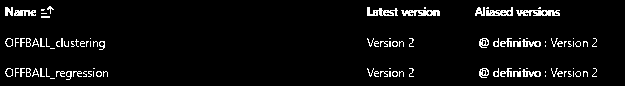
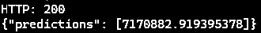
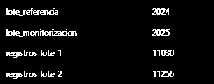
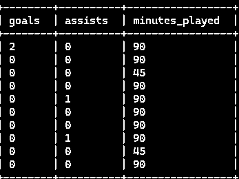

# OFFBALL · cierre técnico del 27 de noviembre de 2026

Evidencias de ejecución local, no simulaciones de capturas. Los recortes de pantalla en PNG conservan los valores originales; se presentan en monocromo y se omiten identificadores de jugadores. Los documentos completos, modelos y datos autorizados se entregan por el canal académico.

## 1. MLflow
Se importaron 56/56 ejecuciones archivadas: 20 de clustering, 26 de integración, 1 de anomalías y 9 de regresión general. Se conservaron métricas, parámetros, artefactos disponibles y referencias al run original. Existían 37 ejecuciones históricas antes de la importación. No se reentrenaron los modelos.

| Modelo | Versión | Alias | Run registrado |
|---|---:|---|---|
| OFFBALL_clustering (GMM K5) | 2 | definitivo | 1756b06af1cd46cb8d5019c8469115df |
| OFFBALL_regression (G02) | 2 | definitivo | 45b20a13d1424e60b8bc7c1d6ab579a9 |

Prueba de Serving de G02 con entrada ficticia: HTTP 200 y predicción de 7170882.919395378 EUR, coincidente con la comprobación del modelo previo a su registro.

[Procedimiento y límites](../../experimentos/mlflow_final/README.md).

## 2. Monitorización histórica
Experimento OFFBALL_Monitorizacion_Drift; run G02_Drift_2024_vs_2025 (96818ca625ea4194aac7f8deec946808): 26 métricas y 9 parámetros. Comparación de valoraciones históricas de 2024 (11030) y 2025 (11256), excluyendo 2026 por ser un periodo incompleto. PSI máximo 0,00498; MAE de 5,20 a 5,57 millones EUR (+7,15 %). No se establece causalidad entre drift de entradas y degradación del error.

[Datos agregados de drift](../../resultados/cierre-2026-11-27/drift_modelo.csv).

## 3. Big Data
Hadoop 3.3.6: NameNode y DataNode con volúmenes persistentes, un DataNode y factor de réplica 1. Se reconstruyó Bronze a partir de las copias CSV verificadas, se convirtió Silver a Parquet Snappy con PyArrow y se cargaron cuatro resultados Gold ya calculados fuera de Hadoop. Se comprobó la persistencia de Bronze con docker compose down/up sin eliminar volúmenes.

| Capa | Archivos | Bytes | Integridad FSCK |
|---|---:|---:|---|
| Bronze | 5 | 223754513 | HEALTHY |
| Silver | 5 | 43939444 | HEALTHY |
| Gold | 4 | 5340494 | HEALTHY |

Reducción Bronze → Silver: 80,36 %. Cero bloques perdidos o corruptos en las tres capas. No equivale a tolerancia a fallos multinodo.

Hive 4.0.0 con Derby integrado y Beeline: cinco tablas externas sobre Parquet; SELECT LIMIT 10 real y cinco COUNT(*) por MapReduce local (sin YARN), con 2690554 registros en total y coincidencia con los recuentos de origen.

[Recuentos y evidencia textual](../../resultados/cierre-2026-11-27/hdfs_hive.csv) · [Configuración y comandos](../../infra/hadoop/README.md).

## 4. Selección de modelos
GMM K5 frente a K6: BIC y AIC medios menores, likelihood de validación superior y ARI medio superior; ARI mínimo menor, por lo que la estabilidad no es uniforme. K-Means histórico tuvo silueta 0,2808 frente a 0,1918 del GMM K6, no de K5. GMM se eligió por la pertenencia probabilística, no por superioridad universal.

G02 frente a G01: sobre 23658 observaciones de test, recall de valoraciones inferiores a 1 M EUR de 69,05 % frente a 12,68 %, con menor precisión y mayor MAE global. G02 apoya la búsqueda por presupuesto, no garantiza precios de traspaso ni fichajes disponibles.

Ampliación de cinco a catorce ligas con histórico suficiente; 31 competiciones examinadas. El embudo histórico extendido pasó de 2505 últimas valoraciones a 116 alertas, 82 dentro del presupuesto, 82 con acuerdo R02 y 8 tras filtro de actualidad en la evaluación histórica. No presentar esos ocho como oportunidades vigentes.

[Métricas K5/K6](../../resultados/cierre-2026-11-27/estabilidad_gmm.csv) · [G01/G02 en test](../../resultados/cierre-2026-11-27/regresion_test.csv) · [validación cruzada](../../resultados/cierre-2026-11-27/regresion_cv.csv) · [embudo](../../resultados/cierre-2026-11-27/embudo_historico.csv).

## Alcance de la evidencia
Resultados registrados en la sesión académica del 27/11; no certifican un despliegue de producción. El acceso a datos y modelos derivados se rige por las condiciones de la fuente. Los scripts de reproducción de Hadoop se han organizado a partir de los comandos verificados, sin ejecutar de nuevo el conjunto como paquete.
